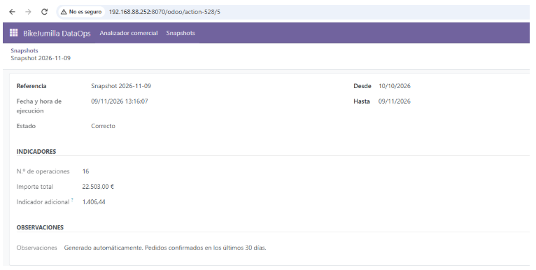
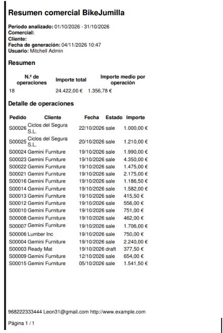
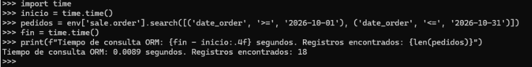

# 🚴‍♂️ BikeJumilla DataOps (Odoo 18)

Módulo de consulta, informes y automatización de datos para **BikeJumilla Distribución, S.L.**, desarrollado como práctica del módulo de *Sistemas de Gestión Empresarial* (2º DAM).

## 📋 Descripción del Proyecto

Este proyecto implementa una capa de **DataOps** sobre Odoo 18 Community, transformando los datos almacenados en el ERP en información útil para la toma de decisiones. 

El módulo incluye:
- **Consultas ORM avanzadas**: dominios, relaciones, agregaciones (`read_group`) y conteos.
- **Formulario "Analizador comercial"**: interfaz gráfica para que los usuarios de negocio realicen consultas parametrizadas.
- **Informe en PDF (QWeb)**: generación de un documento formal con métricas y detalle de operaciones.
- **Exportación de datos**: a formatos Excel/CSV desde el propio ERP.
- **Automatización (Cron)**: extracción periódica de indicadores y almacenamiento en un modelo de *Snapshots*.

  ## 📸 Capturas de Pantalla

| Analizador Comercial | Informe PDF |
| :---: | :---: |
|  |  |
| *Formulario de análisis* | *Documento PDF generado* |

| Pruebas de Rendimiento |  |
| :---: | :---: |
|  | |
| *Medición de tiempos ORM* | |

## 🛠️ Tecnologías Utilizadas
- **Odoo 18 Community**
- **PostgreSQL 15**
- **Docker / Docker Compose**
- **Python 3**
- **XML (QWeb)**

## 🚀 Instalación y Despliegue

1. Clona este repositorio:
   ```bash
   git clone https://github.com/hibridus92-star/bikejumilla-dataops.git
